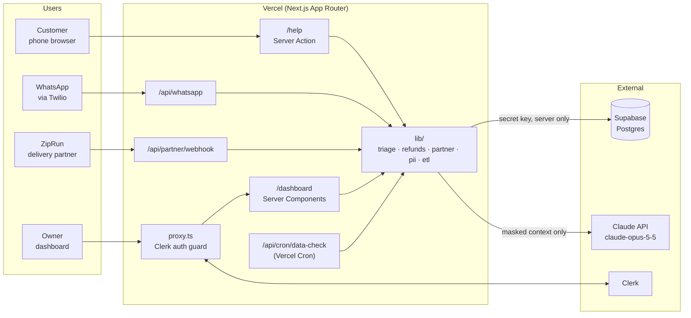
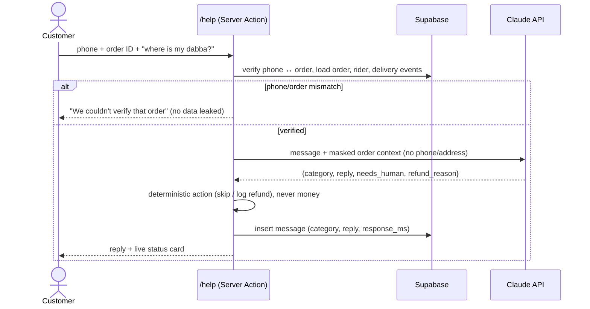
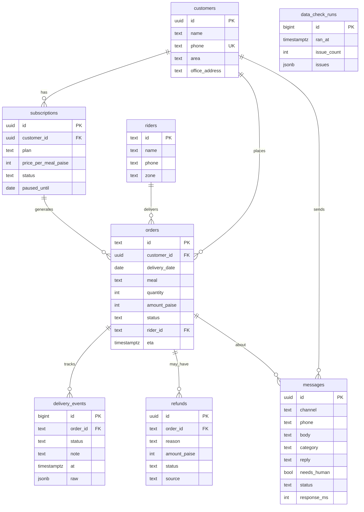

# DabbaDesk — Architecture

## System overview

## Request flow: "Where's my dabba?"

## Data model

## Key decisions
| Decision | Why |
|---|---|
| Supabase is accessed **server-side only** with the secret key (`lib/supabase/server.ts`, `import "server-only"`) | One access path makes it easy to review. No Row-Level Security policies needed on day one. |
| The LLM **classifies and phrases** the reply; **code decides actions** | Money and data changes must be deterministic and testable. |
| Customer identity = phone **and** order ID | Phone alone would let anyone read anyone's order. |
| Money as integer **paise** | No floating-point rounding bugs in refunds. |
| All dates/times in **IST** (`Asia/Kolkata`) | The business runs in Bengaluru. |
| Clerk guards `/dashboard` in `proxy.ts` *and* the page calls `auth()` | Defence in depth. The proxy alone is only an optimistic check. |
| Partner payloads go through an **adapter** (`lib/partner.ts`) | ZipRun changes formats without notice; only one file has to change. |

## LLM choice
- **Model:** `claude-opus-5-5` via `@anthropic-ai/sdk`, with `effort: "low"` (it's a short classification-and-reply task, so speed matters).
- **Structured output** (Zod schema) so the category is always valid JSON.
- **Server-side refusal fallback** (`fallbacks: "default"`) enabled.
- The prompt says: answer only from the provided rows; if the answer isn't there, say a human will reply.
